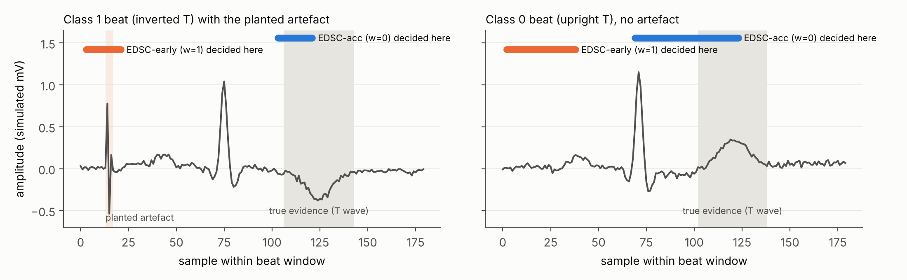
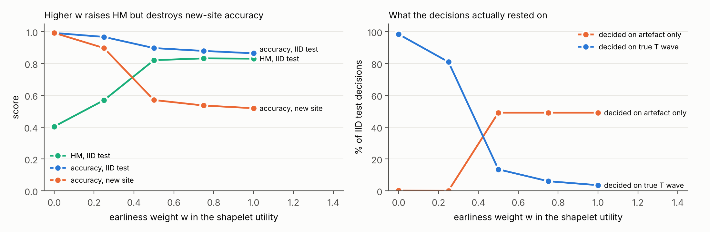
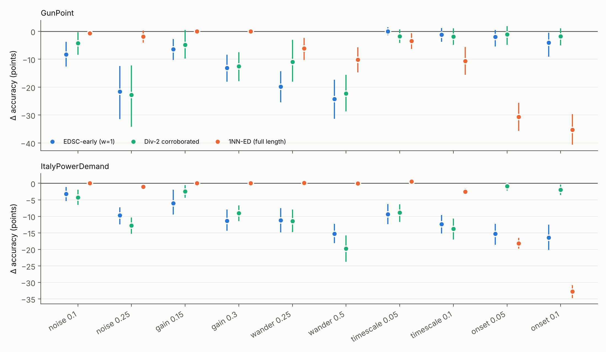

# Early, Correct, and for the Right Reason?

**A reliability pilot for shapelet-based early time-series classification under distribution shift**

Shapelet-based early classifiers decide as soon as a discriminative subsequence appears, and that subsequence doubles
as the explanation. They are usually scored by accuracy and earliness on clean benchmark splits, often combined into a
single harmonic mean (HM). This pilot asks whether they stay correct, early, and correct *for the right reason* when
acquisition conditions change.

## What is in the notebook

* An EDSC-style shapelet early classifier written from scratch in NumPy: random candidate sampling, learned distance
  thresholds, earliness-weighted utility, greedy covering, a first-match rule and a two-shapelet corroborated rule,
  plus an evidence audit that records which subsequence triggered every decision.
* **Experiment A (controlled):** a simulated single-beat ECG benchmark. Class 0 has an upright T wave, class 1 an
  inverted T wave (true evidence, late in the beat). At the training "site" a short spike before the P wave appears in
  90% of class-1 beats and 10% of class-0 beats. Test beats are reused with the same, no, and reversed correlation.
* **Experiment B (real data):** GunPoint and ItalyPowerDemand (UCR) under noise, gain, baseline wander, time scaling
  and onset misalignment, against a full-length 1-NN reference.
* 5 seeds, hierarchical bootstrap 95% confidence intervals, exact McNemar tests per seed with Holm correction.
* Optional cell: the same shift study on ECG200 and TwoLeadECG (needs internet).

## Headline results (5 seeds)

| Simulated ECG | IID acc. | Earliness | HM | Decided on artefact only | Decided on true T wave | New-site Δacc (points) [95% CI] |
|---|---|---|---|---|---|---|
| EDSC-acc (w = 0) | 0.992 | 0.74 | 0.40 | 0.1% | 98.4% | +0.1 [0.0, 0.3] |
| EDSC-early (w = 1) | 0.864 | 0.20 | **0.83** | 49.1% | 3.5% | **−34.5 [−38.3, −30.4]** |
| Dup-2 corroborated | 0.969 | 0.75 | 0.39 | 3.6% | 76.4% | −4.0 [−7.8, −1.6] |
| Div-2 corroborated | 0.968 | 0.70 | 0.45 | 4.2% | 90.3% | −7.7 [−13.1, −3.0] |

* The model with the best HM is the least reliable: rewarding earliness makes the early artefact more attractive than
  the late true evidence.
* On GunPoint, baseline wander (0.5 std) cost the earliness-weighted classifier 24.3 points [−31.3, −17.3]; under a
  ±15% gain change, 16.5% of series stayed correct but switched to a different triggering shapelet.
* Failure modes differ by model family: full-length 1-NN ignored gain but lost 35.3 points under 10% onset
  misalignment, where the shapelet classifier lost 4.0.

## Run it

Open the notebook in Colab (badge above) and choose *Runtime → Run all*. It runs on a CPU in about a minute; the only
extra package is `aeon`, installed automatically to load the UCR datasets. Numbers can differ slightly across NumPy
versions; the notebook prints the headline numbers of your own run.

## Scope and limitations

The classifier is a simplified EDSC-style method, not a re-implementation of any published algorithm. The ECG data in
Experiment A are simulated, the shifts are synthetic, and only two UCR datasets are used in Experiment B. On
ItalyPowerDemand the simplified classifier is much weaker than 1-NN on clean data. No hyperparameter was tuned on test
data. The pilot motivates questions about evaluation; it makes no clinical claim.

## Related work

* L. Ye, E. Keogh. Time series shapelets: a new primitive for data mining. KDD 2009. https://doi.org/10.1145/1557019.1557122
* Z. Xing, J. Pei, P. S. Yu, K. Wang. Extracting interpretable features for early classification on time series. SDM 2011. https://doi.org/10.1137/1.9781611972818.22
* G. Li, W. Yan, Z. Wu. Discovering shapelets with key points in time series classification. ESWA 2019. https://doi.org/10.1016/j.eswa.2019.04.062
* W. Yan, G. Li, Z. Wu, S. Wang, P. S. Yu. Extracting diverse-shapelets for early classification on time series. World Wide Web 2020. https://doi.org/10.1007/s11280-020-00820-z
* G. Li, W. Yan. Extracting distinctive shapelets with random selection for early classification. KSEM 2020. https://doi.org/10.1007/978-3-030-55130-8_41
* P. Schäfer, U. Leser. TEASER: early and accurate time series classification. DMKD 2020. https://doi.org/10.1007/s10618-020-00690-z
* R. Wu, A. Der, E. Keogh. When is early classification of time series meaningful? IEEE TKDE 2021. https://doi.org/10.1109/TKDE.2021.3108580
* R. Geirhos et al. Shortcut learning in deep neural networks. Nature Machine Intelligence 2020. https://doi.org/10.1038/s42256-020-00257-z

## Author

Ashhar Hussain · asharhussain.csit@uokajk.edu.pk · [ORCID 0009-0009-1568-9852](https://orcid.org/0009-0009-1568-9852)

Released under the MIT License.
